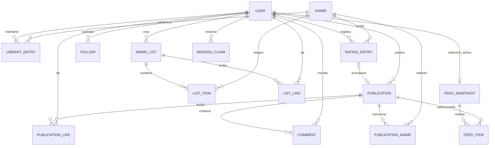
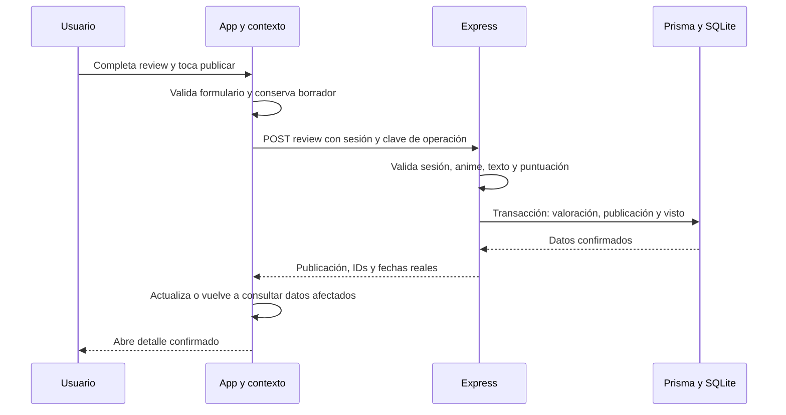

> Documento histórico de la integración anterior. Para la etapa del 25/10/2026 leer la [guía vigente de integración](docs/GUIA_INTEGRACION_FRONTEND.md) y la [auditoría](docs/AUDITORIA_FRONT_BACK.md). Las referencias a ramas anteriores, cinco misiones, rangos por vistos o inclusión de seguidos en Para ti ya no son vigentes.

# Ani-Ren: esquema conceptual de datos, API y flujos

Actualizado: 12 de octubre de 2026. Estado: diseño general y referencia para etapas futuras. Actividad, núcleo social, listas, búsqueda, Para ti y Aura inicial están implementados en el backend; consultar [API.md](API.md) para las rutas disponibles y [prisma/schema.prisma](prisma/schema.prisma) para el esquema real.

## Modelo implementado y diferencias respecto del diseño general

- AniList se consulta por `idMal` para personajes, voces japonesas y enlaces en una ruta independiente `/api/anime/:id/extras`. No modifica el esquema de Prisma ni resuelve licencias territoriales. Los datos complementarios tienen caché temporal en memoria y su ausencia no bloquea actividad social. Uso sujeto a aclarar compatibilidad con las condiciones del proveedor; no reemplaza el catálogo principal.

- Jikan/MyAnimeList usa una referencia canónica `mal:ID`, también como clave de Anime. No existe agrupación de temporadas ni equivalencia entre proveedores.
- Tenrai reemplaza el servicio público cerrado de Jikan: mismo formato y referencias `mal:ID`, búsqueda/detalle/paginación verificados. No modifica los IDs ni los datos persistidos. AniList permanece como fuente complementaria.
- User, Session, Anime, LibraryEntry, RatingEntry, Publication, PublicationAnime, Follow, PublicationLike, Comment y Operation están implementados. Biblioteca contiene visto, watchlist y posición de favorito.
- Publication tiene kind review/post y ratingEntryId nullable y único. Un CHECK SQL obliga a que solo las reviews tengan valoración. La migración social conserva reviews previas. PublicationAnime guarda las referencias explícitas de posteos y su posición, sin duplicados.
- Las etiquetas se extraen del texto actual para respuestas, búsquedas exactas por hashtag e intereses de Para ti. No se necesitan tablas de etiquetas ni backfill de las reviews previas en esta versión. No se transforma automáticamente un hashtag en referencia de anime.
- Amigos se calcula desde seguimientos recíprocos. No hay tabla de solicitudes de amistad. Likes únicos por usuario/publicación; comentarios asociados al ID de publicación, con autor y fecha.
- Perfil editable: nombre y biografía. Avatar y fecha de modificación de perfil no están implementados. Comment no tiene updatedAt porque su edición no está disponible.
- AnimeList, ListItem y ListLike están implementados: orden persistido incluso cuando ordered=false, pares únicos y reemplazo atómico del contenido, sin afectar actividad personal.
- FeedSnapshot y FeedItem conservan la selección de Para ti: una selección activa por cuenta, vencimiento a los 20 minutos, publicaciones/posiciones únicas, puntuación y motivos. Se calcula antes de paginar y se revalidan exclusiones al leer. Son datos temporales del servidor, no historial de vistos.
- MissionClaim guarda userId/missionId únicos, recompensa otorgada, versión de reglas y claimedAt. Progreso y rango se derivan de actividad real: no se guarda un contador editable por cliente ni se usa Operation para reclamos (PUT idempotente por identidad de misión). Las cinco definiciones y umbrales están en src/modules/aura/aura.ts; fueron confirmados el 12/10/2026.
- Los IDs autoincrementales de actividad/publicación establecen orden de inserción y cursor. Se devuelven como strings opacos para el frontend.
- Las sesiones usan tokens aleatorios, hash SHA-256 en SQLite, expiración fija y revocación. Las contraseñas usan scrypt.
- Operation almacena la respuesta del POST de valoración, review, post, comentario o lista en la misma transacción para reconocer reintentos. Biblioteca permite watched=true, watchlist true/false y reemplazo de favoritos; desmarcar visto y borrados continúan pendientes.
- Hay pruebas automatizadas de actividad, núcleo social, listas, búsqueda, recomendaciones y migración con datos previos. No implican que Expo ya consuma esta API ni que las funcionalidades futuras estén implementadas.

Las decisiones de producto y el orden de trabajo están en [PLAN_IMPLEMENTACION.md](PLAN_IMPLEMENTACION.md). Las rutas y nombres siguientes son un contrato inicial propuesto: deben cerrarse por bloque antes de programar.

## 1. Principios del modelo

1. Una entrada externa corresponde a una entrada de catálogo local. Un ID interno solo sirve para relaciones de nuestra base: no agrupa temporadas ni cambia la identidad del proveedor.
2. Biblioteca, valoraciones y publicaciones cumplen funciones diferentes.
3. Un usuario puede tener muchas valoraciones de un anime. No imponer unicidad sobre usuario/anime en las valoraciones.
4. Una review referencia exactamente una valoración. Una valoración puede existir sin review.
5. Las estrellas se guardan en un solo lugar: la valoración. La respuesta de una review puede incluirlas sin duplicarlas en otra tabla.
6. Una publicación común no tiene puntuación; puede referenciar varios animes.
7. Contadores y promedios se calculan desde los datos del servidor, no desde lo cargado en una pantalla.

## 2. Relaciones principales

El diagrama resume relaciones; las restricciones condicionales están debajo. `FOLLOW` tiene dos referencias a usuario: seguidor y seguido. El enlace opcional publicación/valoración es obligatorio únicamente para publicaciones de tipo review.

### Entidades y campos propuestos

| Entidad | Campos principales | Restricciones y propósito |
| --- | --- | --- |
| User | id, handle, normalizedHandle, passwordHash, name, bio, avatarUrl opcional, createdAt, updatedAt | Handle normalizado único; jamás devolver passwordHash. ID/handle no editables desde perfil |
| Anime | id, provider, externalId, title, synopsis opcional, imageUrl opcional, metadatos disponibles, fetchedAt | Único por provider/externalId; una sola entrada externa por registro, sin agrupación |
| LibraryEntry | userId, animeId, watched, watchlist, favoritePosition opcional | Único por userId/animeId; posición permite favoritos ordenados; no contiene estrellas |
| RatingEntry | id, userId, animeId, rating, watchedOn opcional, rewatched, createdAt, updatedAt opcional | Muchas entradas por usuario/anime; rating entre 0,5 y 5 en medios puntos |
| Publication | id, userId, kind, ratingEntryId opcional, title opcional, text, spoiler, createdAt, updatedAt opcional | kind review/post; ratingEntryId único y obligatorio en review, ausente en post |
| PublicationAnime | publicationId, animeId | Referencias explícitas de posteos, sin duplicados; el anime principal de una review sale de su valoración |
| Tag / PublicationTag | tagId, normalizedName / publicationId, tagId | Etiquetas normalizadas y relación sin duplicados; no asumir que todo hashtag es un anime |
| Follow | followerId, followedId, createdAt | Par único; no seguirse a sí mismo |
| PublicationLike | userId, publicationId, createdAt | Par único; máximo un like propio por publicación |
| Comment | id, publicationId, userId, text, createdAt, updatedAt opcional | Autor desde sesión; texto no vacío; límite por acordar |
| AnimeList | id, userId, title, description, ordered, createdAt, updatedAt | Autor desde sesión; título requerido |
| ListItem | listId, animeId, position | Anime no repetido en una lista; preservar orden incluso si ordered es falso |
| ListLike | userId, listId, createdAt | Par único |

Los géneros del catálogo se normalizarán a valores estables para filtros y misiones. Su representación concreta se decide con los datos del proveedor. El esquema definitivo incluirá claves foráneas e índices para consultas por autor, anime, fecha y relaciones.

Aura inicial y sesiones ya tienen reglas y modelos implementados según el apartado de estado. País, decoradores equipables y subida de archivos siguen pendientes: no tratarlos como reglas cerradas.

## 3. Invariantes y métricas

### Crear y editar

- Crear una valoración nueva siempre genera otro ID. Editar usa el ID existente.
- Crear una review escribe valoración, publicación y estado visto dentro de una transacción. Si algo falla, no queda una parte guardada.
- Autor y anime de la review deben coincidir con los de su valoración. No permitir enlazar valoraciones ajenas o ya asociadas a otra publicación.
- Editar las estrellas de una review modifica su valoración y la fecha de modificación de la publicación en la misma transacción.
- Una valoración con review se edita por la operación de review; la edición de valoración sin texto no debe permitir eludir esa coherencia.
- La fecha de creación permanece igual al editar. El feed cronológico usa creación; editar no mueve automáticamente la publicación al principio.
- Dar estrellas marca visto. Marcar visto directamente no crea valoración ni publicación.
- Rewatched es una marca declarada por el usuario; no exige un registro anterior en Ani-Ren.

### Cálculos

| Dato | Cálculo |
| --- | --- |
| Promedio Ani-Ren | Suma de todas las puntuaciones vigentes de RatingEntry del anime / cantidad de esas entradas |
| Cantidad de valoraciones | Número de RatingEntry del anime |
| Cantidad de reviews | Número de Publication kind=review asociadas al anime |
| Usuarios que valoraron | Cantidad de userId distintos en esas valoraciones |
| Puntuación personal actual | Valoración del usuario/anime con createdAt más reciente; desempate estable definido por servidor |
| Vistos personales | LibraryEntry con watched=true; un registro por usuario/anime |
| Misión de género | IDs distintos vistos que pertenecen a ese género |
| Seguidores y seguidos | Relaciones Follow correspondientes |
| Amigos | Seguimientos recíprocos |

Sin valoraciones, devolver promedio `null`, no cero. Redondear para mostrar, no cada voto antes de sumar. Una edición reemplaza el valor de esa entrada, sin sumar un nuevo voto. Los períodos y efectos de borrado se definirán antes de implementar esas funciones.

### Fechas

- createdAt y updatedAt: instantes emitidos por el servidor, en UTC y formato ISO 8601; presentar en hora local.
- watchedOn: fecha de calendario elegida por el usuario, sin convertirla inadvertidamente al día anterior/siguiente por huso horario.
- Conservar separación entre fecha de visto, publicación y modificación. Propuesta: watchedOn opcional; si se informa, debe ser real y no futura según la regla de zona acordada para la app.
- Mostrar «Editado» solo cuando hubo una modificación, junto con updatedAt.

## 4. Convenciones de API propuestas

- Prefijo `/api`, solicitudes y respuestas JSON.
- Autor siempre obtenido de la sesión. No aceptar userId del cuerpo como prueba de identidad.
- Respuestas sin contraseñas, hashes ni datos internos de sesión.
- IDs opacos para el cliente. El frontend no construye IDs a partir de usuario/anime.
- Listados con `items` y `nextCursor`; agregar `total` cuando la pantalla lo necesite. Tamaño máximo de página controlado por servidor.
- Orden estable, por ejemplo createdAt descendente y un desempate único. El cursor pertenece a los filtros usados.
- Para ti se selecciona en servidor: no ordenar una sola página como si fuera todo el catálogo. Definir estabilidad de paginación de recomendaciones en su etapa.
- Respuestas de escritura devuelven el recurso confirmado y los datos necesarios para actualizar la interfaz.
- Error uniforme propuesto: `error.code`, `error.message` y `error.fields` opcional para formularios. No devolver trazas internas.

| Estado HTTP | Uso |
| --- | --- |
| 200 | Lectura o modificación exitosa |
| 201 | Recurso creado |
| 204 | Operación exitosa sin cuerpo |
| 400 | Entrada inválida |
| 401 | Sesión ausente, inválida o vencida |
| 403 | Sesión válida sin permiso para la acción |
| 404 | Recurso inexistente |
| 409 | Conflicto, por ejemplo handle ocupado |
| 429 | Límite temporal de solicitudes |
| 500 | Error interno inesperado |
| 502/503 | Fallo o indisponibilidad de una dependencia, según el caso |

### Registro y validación

Conservar inicialmente las reglas actuales del frontend: usuario de 3 a 20 caracteres ASCII, números o guion bajo; comparación sin mayúsculas y con extremos recortados. Contraseña de al menos ocho caracteres, una letra y un número; no recortarla ni cambiar mayúsculas. Confirmación de contraseña es una ayuda del formulario.

Validar también en servidor; nunca usar `usuarios-demo.json` como autenticación real. Definir algoritmo de hash y protección de login antes de implementar.

Mantener provisionalmente las reglas actuales del editor: review con texto de 10 a 2000 caracteres y título opcional de hasta 100; posteo de 3 a 2000. Confirmar límites y aplicar los mismos criterios en ambos lados. Los registros legacy sin puntuación requieren una decisión de migración, no relajar silenciosamente las nuevas altas.

## 5. Operaciones del primer recorrido

| Método y ruta propuestos | Entrada/función | Respuesta o efecto |
| --- | --- | --- |
| GET /api/health | Comprobar disponibilidad | Estado básico sin secretos |
| POST /api/auth/register | handle, password | Usuario creado; inicialmente ingresar después por login |
| POST /api/auth/login | handle, password | Perfil y mecanismo de sesión elegido |
| GET /api/auth/me | Sesión | Cuenta activa |
| POST /api/auth/logout | Sesión | Cierre/revocación conforme al mecanismo elegido |
| GET /api/anime?q=... | Búsqueda y paginación del proveedor | Entradas del catálogo normalizadas para la UI |
| GET /api/anime/:id | Identidad estable de catálogo | Metadatos y métricas propias claramente separadas |
| GET /api/me/library | Filtro y paginación | Biblioteca propia y totales |
| PATCH /api/me/library/:animeId | Estado deseado, inicialmente watched | Registro confirmado; reglas de desmarcar pendientes |
| GET /api/me/anime/:animeId/activity | Historial paginado | Puntuación actual, estado de biblioteca e historial |
| POST /api/ratings | animeId, rating, watchedOn opcional, rewatched | Nueva valoración sin publicación; marca visto |
| PATCH /api/ratings/:id | Campos editables de valoración sin review | Misma valoración actualizada, solo autor |
| POST /api/reviews | animeId, rating, text, title opcional, spoiler, watchedOn opcional, rewatched | Valoración + publicación + visto, de forma atómica |
| PATCH /api/reviews/:id | Campos editables | Publicación y valoración actualizadas, solo autor; id es el de publicación |
| GET /api/publications | Filtro por anime o autor, paginación | Reviews/posts; nunca valoraciones sin texto |
| GET /api/publications/:id | ID de publicación | Detalle y estado de interacciones |

El catálogo necesita un contrato inequívoco entre resultados externos y referencias locales. Propuesta: utilizar una clave formada por proveedor e ID externo en la API pública; resolver/crear su referencia local al guardar actividad. No confundir ese identificador con el ID privado de SQLite. Cerrar su formato con el proveedor antes de implementar.

Los borrados de publicaciones/valoraciones quedan fuera del primer contrato hasta acordar sus efectos sobre biblioteca, promedio, comentarios y puntuación personal actual. No heredar las reglas del DELETE de personas del ejemplo sin adaptarlas.

## 6. Operaciones posteriores

| Bloque | Operaciones propuestas |
| --- | --- |
| Perfiles | GET /api/users/:id; PATCH /api/me/profile |
| Posteos | POST /api/posts; PATCH /api/posts/:id |
| Seguimientos | PUT y DELETE /api/me/following/:userId; consultas paginadas de seguidores/seguidos |
| Likes de publicación | PUT y DELETE /api/publications/:id/like |
| Comentarios | GET y POST /api/publications/:id/comments |
| Feeds | GET /api/feed?type=following o for-you, con cursor |
| Favoritos | PUT /api/me/favorites con IDs ordenados, sin duplicados |
| Listas | GET/POST /api/lists; GET/PATCH /api/lists/:id; reemplazo ordenado de contenido por su autor |
| Likes de lista | PUT y DELETE /api/lists/:id/like |
| Búsqueda | Consultas por categoría, incluyendo publicaciones/etiquetas, usuarios y listas |

PUT/DELETE para likes y seguimientos representan un estado deseado. Repetir «dar like» no lo quita accidentalmente. Las restricciones únicas de la base previenen duplicados incluso con solicitudes simultáneas.

Para crear valoraciones/reviews, definir una clave de operación que permita reconocer reintentos del mismo envío. Dos envíos intencionalmente nuevos sí crean dos entradas; reintentar una solicitud cuya respuesta se perdió no debería duplicarla. El botón deshabilitado por sí solo no cubre este caso.

## 7. Flujos de integración

### Publicar una review

Si falla, devolver un error, conservar el borrador y permitir reintentar. Si se perdió la respuesta después de guardar, la clave de operación debe permitir recuperar el mismo resultado. Una segunda cuenta consulta el servidor y ve la publicación; no se requiere tiempo real en esta etapa.

### Puntuar sin texto

Formulario → crear RatingEntry → marcar LibraryEntry.watched → confirmar → actualizar promedio, puntuación personal e historial. No insertar Publication y no sumar reviews.

### Restaurar sesión

Leer credencial local → comprobar sesión con servidor → cargar cuenta → consultar datos necesarios. Si la sesión venció, pedir ingreso; distinguir sesión inválida de falta de red. Nunca autenticar por conocer un ID de usuario.

### Consultar catálogo

App → backend → proveedor o metadatos conservados según política acordada → normalización de campos → respuesta. No cambiar relaciones locales cuando cambie el título externo. Manejar metadatos faltantes y fallo del proveedor sin perder las reviews existentes.

### Descubrir animes con Para ti

Primera consulta → leer intereses de favoritos/watchlist y etiquetas gustadas → candidatos de desconocidos con referencias no vistas → puntuar el conjunto → ordenar y alternar autores → guardar selección temporal → devolver primera página con motivos y cursor.

Página siguiente → comprobar cuenta y vencimiento del cursor → excluir autores ahora seguidos y referencias ya vistas → devolver siguiente tramo en el mismo orden. Al recargar se incluyen las nuevas señales/publicaciones. Si la selección fue reemplazada o venció, responder 410 para que Expo reinicie la consulta, conservando la sesión.

### Reclamar una recompensa

App consulta Aura/misiones → usuario toca reclamar → PUT con sesión e ID de misión → transacción lee reclamo existente o calcula objetivo desde biblioteca/publicaciones completas → rechaza objetivo incompleto con 409 o guarda MissionClaim único → devuelve recompensa y fecha confirmadas. Reintentar devuelve el mismo reclamo; no suma puntos, vistos ni otra recompensa. Un cambio de metadatos no borra desbloqueos ya otorgados.

## 8. Adaptación del frontend existente

Rutas relativas a `../ani-ren-app`, rama `context`:

| Punto | Cambio necesario |
| --- | --- |
| src/context/SessionContext.tsx y src/login.ts | Sustituir cuentas JSON e ID persistido por autenticación real |
| src/context/PublicationsContext.tsx | Reemplazar colección local completa por consultas; distinguir nueva valoración/review de edición por ID |
| src/publications.ts | Adaptar contrato con valoración asociada, fechas y marca rewatched |
| src/context/AppState.tsx | Consultar biblioteca real; eliminar dependencia de inferir todos los vistos de reviews locales |
| app/crear/review/escribir.tsx | Separar «nueva entrada» y «editar»; enviar una operación atómica, mostrar última puntuación sin sobrescribir historial |
| src/context/ProfilesContext.tsx | Consultar perfiles por ID y confirmar cambios propios |
| src/context/SocialContext.tsx | Consultar relaciones y totales; no cargar todo el grafo social |
| src/context/ListsContext.tsx | Consultar listas y conservar posiciones |
| src/feed.ts y app/(tabs)/inicio.tsx | Consumir selección/paginación del servidor |
| src/useDirectory.ts y src/useCurrentUser.ts | Resolver perfiles sin depender de que todos los usuarios estén en mock.ts |
| src/missions.ts y src/useMissions.ts | Mantener progreso de vistos sobre IDs distintos; luego trasladar validación de recompensas al servidor |

El código actual busca una entrada por usuario/anime y genera IDs de review basados en ese par. Eso debe cambiar para soportar el historial acordado. No reutilizar una búsqueda `.find()` como criterio implícito de puntuación actual.

Mantener formularios, navegación y componentes visuales cuando sea posible. Consultar y adaptar en los contextos/puntos de datos, sin disparar una llamada por cada tarjeta repetida. Tras una escritura, actualizar o invalidar el detalle, listado, biblioteca y métricas afectados. Al cambiar de cuenta, limpiar datos privados y evitar que respuestas tardías de la sesión anterior contaminen la nueva.

## 9. Casos de aceptación del esquema

1. Usuario A puntúa una entrada con 3,5 sin texto: una valoración, cero reviews, un visto.
2. A crea review de la misma entrada con 4,5: dos valoraciones, una review, promedio 4, puntuación personal 4,5 y un visto.
3. A crea dos reviews con texto en entradas de valoración separadas: ambas conservan interacciones independientes.
4. A edita la valoración antigua de 3,5 a 2,5: promedio 3,5; puntuación personal sigue 4,5; no aumenta el número de entradas.
5. B intenta editar una review de A: operación rechazada, sin modificación de datos.
6. A valora diez veces el mismo anime de Romance: progreso de animes distintos de Romance igual a uno.
7. Dos temporadas tienen IDs externos diferentes: fichas, promedios y biblioteca separados, sin fusión.
8. A marca «Lo volví a ver»: se muestra el indicador, sin agregar un contador de repeticiones ni otro visto por sí solo.
9. Editar una review conserva createdAt y registra updatedAt; las interacciones siguen ligadas a su ID.
10. Reiniciar servidor conserva cuentas, publicaciones y biblioteca confirmadas.
11. Reintentar el mismo envío tras perder la respuesta no duplica una review; crear una nueva intencionalmente sí.
12. Una página con cinco reviews no informa cinco como total si el servidor tiene más.

Estos casos se convertirán en pruebas del backend e integración cuando exista implementación. No afirman que el frontend actual ya cumpla las nuevas reglas.
