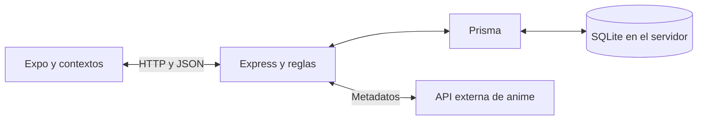

> Actualización 18/10/2026: las reglas vigentes de puntuación, Para ti y Descubrir están en API.md y README.md. Un voto vigente por persona; editar estrellas actualiza ese voto. Para ti incluye vistos y seguidos; Descubrir agrupa solo animes no vistos. El frontend integrado está en feature/integracion-backend. Las notas históricas que contradigan estas reglas quedan reemplazadas.

# Ani-Ren: metodología y plan de implementación

Actualizado: 12 de octubre de 2026. Estado: backend de actividad, núcleo social, listas, búsqueda, Para ti y primer bloque de Aura implementados; integración con Expo pendiente.

## Avance de implementación

Cierre para integración local (12/10/2026): Tenrai reemplaza el servicio público de Jikan; búsqueda, detalle y paginación verificados en vivo, manteniendo IDs `mal:ID`. AniList continúa para extras. El siguiente trabajo está en el frontend y se guía por [HANDOFF_FRONTEND.md](HANDOFF_FRONTEND.md), que delimita la primera versión integrable y los módulos futuros. No se declara terminada la integración móvil hasta probarla en teléfono.

Complemento del 12/10/2026: AniList permite consultar personajes, voces japonesas y enlaces de streaming por `idMal` mediante `/api/anime/:id/extras`. Consulta real de Naruto verificada; `npm.cmd run check:anilist` reproduce la prueba sin frontend. No reemplaza la búsqueda principal de Jikan ni certifica disponibilidad por país. Aclarar la admisibilidad de Ani-Ren según las condiciones del proveedor antes de adoptarlo para publicación. Ver contrato y límites en API.md.

Se implementó la API de usuarios/sesiones, catálogo Jikan, vistos, valoraciones y reviews del primer recorrido. También perfil editable, posteos, seguimientos y amigos, likes, comentarios, ambos feeds, watchlist, favoritos, listas y búsqueda. El primer bloque de etapa 4 agrega Aura, cinco misiones, reclamos únicos y ranking de usuarios global/amigos. El contrato real está en [API.md](API.md), la instalación y los límites en [README.md](README.md). Tendencia, país/mapa, imágenes, equipar decoradores e integración con Expo siguen pendientes.

Decisiones técnicas tomadas al comenzar: Prisma 6.19.3, Jikan con IDs `mal:ID`, sesiones opacas revocables de siete días, scrypt para contraseñas, fecha de visto opcional y zona America/Buenos_Aires configurable. No se importaron datos demo. Los metadatos se conservan en servidor; no hay sincronización offline. En móvil se prevé almacenamiento seguro del token y en web sesión en memoria para la primera integración, todavía no implementada.

El servidor pasó pruebas HTTP con SQLite y dos sesiones. Tras el cierre de Jikan público se conectó Tenrai y se verificaron búsqueda, detalle y paginación en vivo. La etapa 1 completa no se declara terminada hasta conectar Expo y probar en teléfono.

Por decisión del usuario se continuó el backend antes de conectar Expo. La suite social usa tres cuentas y un catálogo controlado solo en tests. En funcionamiento normal, los posteos sin referencias, perfiles, relaciones e interacciones no necesitan al proveedor. Referenciar un anime nuevo requiere obtener sus metadatos de Tenrai. No se agregaron datos demo al servidor.

Este documento organiza el trabajo. El detalle conceptual de datos, operaciones y flujos está en [ESQUEMA_DATOS_Y_API.md](ESQUEMA_DATOS_Y_API.md).

## 1. Objetivo y referencias

Construir el backend de una red social para descubrir y recomendar anime. La primera entrega funcional debe permitir crear una cuenta, ingresar, elegir un anime, publicar una review y verla desde otra cuenta, conservando los datos después de reiniciar.

Referencias consultadas:

- Frontend: https://github.com/Feliflachs/ani-ren-app. La base de trabajo es la copia local en la rama `context`; `main` todavía contiene una versión anterior.
- Handoff: `../ani-ren-app/HANDOFF.md`, actualizado al 10 de octubre. Sus decisiones se conservan salvo las reemplazadas explícitamente en esta conversación y este documento.
- Ejemplo móvil: https://github.com/Feliflachs/TP3-apps---Felipe-Flachsland-mobile.
- Ejemplo servidor: https://github.com/Feliflachs/TP3-apps---Felipe-Flachsland-backend.
- Apuntes: https://docs.google.com/document/d/1AEHgvEbxUEKtIMNTam3IsS3GZfl7T-Gc62Zbl9nKoyU/edit.

La materia prioriza entender el código, justificar herramientas y decisiones, persistir datos y manejar errores. No copiar toda la estructura del ejemplo sin entenderla.

## 2. Decisiones de producto acordadas

### Catálogo y temporadas

- Respetar las entradas tal como las entregue la API elegida.
- No crear agrupaciones propias, unir temporadas manualmente ni mantener equivalencias entre franquicias.
- Si el proveedor entrega dos temporadas como dos entradas, cada una tiene su ficha, puntuaciones, reviews y estado en biblioteca.
- Naruto y Naruto Shippuden no se fusionan. Tampoco se fusionan Frieren 1 y 2 si vienen separados.
- Para contadores y misiones, «anime distinto» significa una entrada distinta del catálogo. Dos temporadas con IDs diferentes pueden contar como dos entradas; valorar dos veces el mismo ID cuenta como una sola.
- Esto reemplaza la propuesta anterior de una ficha unificada por anime. La preferencia visual por agrupar temporadas se descarta para mantener un alcance viable.

### Actividad, valoraciones y publicaciones

- Marcar como visto no exige puntuar ni escribir.
- Puntuar sin texto registra una valoración y marca visto, sin generar una publicación vacía.
- Se pueden crear varias valoraciones y varias reviews del mismo usuario para una misma entrada del catálogo.
- Una nueva review es una publicación independiente, con sus propios likes y comentarios.
- Una review nueva requiere texto y puntuación. Un posteo común no requiere puntuación y puede mencionar varios animes.
- Una review con puntuación aporta una sola valoración al promedio.
- Todas las valoraciones cuentan para el promedio, incluidas las repetidas de un mismo usuario y las que no tienen texto.
- La puntuación personal actual es la de la valoración creada más recientemente. Editar una antigua no la convierte en la más reciente.
- Editar modifica la misma entrada, conserva su fecha de creación y agrega/actualiza la fecha de última modificación. No crea otro voto ni otra publicación.
- Si cambia la puntuación de una valoración existente, se recalcula su aporte al promedio.
- «Lo volví a ver» es un indicador sí/no, que puede mostrarse con flechas circulares. No se pide número de visualización ni se infiere de cuántas reviews existen.
- La fecha de visto, la fecha de creación y la fecha de modificación son datos diferentes.
- Las puntuaciones son de 0,5 a 5, con pasos de media estrella. El promedio puede tener decimales intermedios.

Ejemplo aceptado: una persona valora Naruto con 3,5 y luego con 4,5. Si no hay otras valoraciones, el promedio es 4; su puntuación actual es 4,5; hay dos valoraciones, dos reviews si ambas tienen texto y un anime distinto visto.

### Misiones y estadísticas

- Una misión de ver dos animes de Romance requiere dos IDs distintos marcados como vistos, con ese género.
- Repetir una valoración o marcar «Lo volví a ver» no incrementa la cantidad de animes distintos vistos.
- Confirmado el 12/10/2026: la misión de tres reviews cuenta tres publicaciones nuevas, aunque sean del mismo anime. Una edición no suma. Valoraciones sin texto y posteos no son reviews.
- Confirmado el 12/10/2026: conservar las cinco misiones actuales del frontend y rangos Novato/Aprendiz/Experto/Maestro/Leyenda cada 100 animes distintos vistos. Recompensas únicas por usuario/misión, sin puntos adicionales.
- Diferenciar siempre cantidad de valoraciones, cantidad de reviews y cantidad de usuarios que valoraron.
- La puntuación principal es la de Ani-Ren. Una puntuación externa futura deberá identificar fuente y escala, sin mezclarse con el promedio propio.

### Descubrimiento y comunidad

- Siguiendo: posteos y reviews de cuentas seguidas, inicialmente por fecha de creación.
- Para ti tiene como propósito descubrir animes según los gustos del lector, mediante gente que no sigue. Excluye publicaciones propias y de seguidos, y exige al menos un anime referenciado no marcado como visto. Los pendientes no vistos sí pueden aparecer. Posteos sin referencias siguen disponibles en Siguiendo/perfiles/búsqueda, pero no sirven como candidatos de descubrimiento.
- Conservar inicialmente las reglas sencillas de `src/feed.ts`: coincidencia con watchlist +3; cada género coincidente +1; cada etiqueta coincidente con intereses o etiquetas gustadas +1. Desempatar por fecha y alternar autores cuando sea posible.
- Sin señales coincidentes, ofrecer contenido de otras cuentas por fecha. No rellenar Para ti con Siguiendo.
- Los intereses iniciales son géneros de favoritos/watchlist y etiquetas de publicaciones gustadas, como en el front. No interpretar aún estrellas o likes de listas como señales nuevas. Puntuar solo los animes no vistos de un post mixto; mantener reviews independientes del mismo anime.
- Para ti guarda una selección por cuenta durante 20 minutos para conservar orden al paginar. Al continuar se revalidan seguidos y vistos. Recargar sin cursor genera otra selección; cursor vencido/reemplazado devuelve 410. Motivos y afinidad corresponden al momento de selección, con cuerpos e interacciones actuales.
- Posteo y review comparten el sistema de likes, comentarios, spoilers y etiquetas.
- Amigos significa seguimiento mutuo; no se agrega un sistema separado de solicitudes de amistad.

## 3. Arquitectura y límites

Base técnica: Node.js, Express, TypeScript, Prisma y SQLite, siguiendo el ejemplo de clase. Las versiones compatibles se comprobarán al iniciar la implementación; no copiar versiones por inercia.

- Expo presenta datos y conserva borradores de formularios.
- Express valida solicitudes, autentica, aplica reglas y prepara respuestas.
- Prisma accede a SQLite y permite controlar cambios del esquema.
- SQLite conserva los datos en un archivo del servidor, inicialmente en la computadora de desarrollo. No es una base instalada en cada teléfono.
- La API de anime aporta metadatos; usuarios, reviews y relaciones de Ani-Ren pertenecen a nuestra base.
- Usar un único servidor, organizado por responsabilidades. No introducir microservicios, colas ni infraestructura sin una necesidad concreta.
- El teléfono deberá alcanzar la dirección de la computadora; `localhost` en el teléfono apunta al propio teléfono. Documentar la URL de desarrollo como en el ejemplo.
- El alojamiento público no está elegido. Trabajar localmente no equivale a tener el servidor publicado y disponible permanentemente.

### Qué queda en el teléfono

| Información | Ubicación prevista |
| --- | --- |
| Datos de la pantalla y respuestas recientes durante el uso | Memoria/contextos, con carga acotada |
| Idioma y tema, cuando existan | Preferencias locales pequeñas |
| Borradores | Locales y limitados; separar por cuenta |
| Credencial de sesión | Almacenamiento apropiado y seguro para cada plataforma, por definir |
| Publicaciones, biblioteca, listas, relaciones y cuentas | Backend y SQLite |

La app requiere conexión para consultar y guardar datos remotos. No descargar todo el catálogo ni persistir todo el feed. Sin conexión, explicar el problema y permitir reintentar; conservar el borrador si falla un guardado. No hay sincronización offline ni cola de publicaciones en la primera versión.

## 4. Etapas y criterios de cierre

### Etapa 0: diseño y preparación

Entregables: estos dos documentos y resolución de los pendientes que bloquean la etapa 1.

1. Proveedor actual: Tenrai, compatible con Jikan v4; identidad MAL y acceso real verificados. Respetar límites y revisar condiciones vigentes antes de publicar el servicio.
2. Verificar datos reales de ejemplos representativos: temporadas separadas, título alternativo, sin imagen y datos incompletos. Consumirlos como vienen; no construir agrupaciones.
3. Sesión elegida: token opaco con hash en SQLite, expiración y logout revocable; contraseñas con scrypt. Implementar el almacenamiento móvil/web al integrar Expo.
4. Revisar el modelo conceptual y el contrato propuesto del segundo documento.
5. Acordar tratamiento de los datos demo: propuesta inicial, conservar la demo aparte y empezar el servidor con datos de prueba nuevos; no importar silenciosamente contraseñas ni publicaciones locales.

Cierre: proveedor y autenticación definidos, contrato del primer recorrido revisado y ninguna duda estructural sobre valoraciones repetidas o identidad del catálogo.

### Etapa 1: primera versión de extremo a extremo

Orden de implementación:

1. Preparar proyecto, configuración de entorno, conexión a SQLite, migraciones y comprobación de salud.
2. Crear usuarios, registro, ingreso, consulta de sesión y cierre.
3. Integrar búsqueda/ficha del catálogo y referencias persistentes a los animes utilizados.
4. Implementar biblioteca mínima: marcar visto y consultar actividad propia.
5. Crear valoraciones sin texto y reviews con texto; admitir múltiples entradas desde el comienzo.
6. Implementar edición propia, detalle, listado básico y promedio de Ani-Ren.
7. Adaptar los contextos del frontend, agregando estados de carga y error.
8. Ejecutar el recorrido con dos cuentas y dos sesiones independientes.

Criterios de cierre:

- Crear cuenta, ingresar, buscar anime, publicar y consultar desde otra cuenta.
- Puntuar sin texto no genera una tarjeta vacía.
- Dos valoraciones del mismo usuario producen el promedio y los contadores acordados.
- Reiniciar servidor y app no pierde datos confirmados.
- Una cuenta no puede editar datos de otra, incluso enviando una solicitud manual.
- Un fallo al guardar conserva el borrador y no muestra éxito falso.
- La sesión se restaura mediante una credencial válida, no por confiar en un ID guardado.

### Etapa 2: núcleo social y biblioteca

Implementar perfiles editables básicos, posteos comunes, seguir/dejar de seguir, likes, comentarios y Siguiendo. Completar watchlist y favoritos ordenados. Incluir publicaciones por usuario y etiquetas/referencias de anime.

Estado del servidor: implementado y probado. `kind` distingue review y post; las referencias explícitas usan IDs del catálogo. Hashtags se derivan del texto, sin resolver automáticamente títulos ni almacenar aún tablas de etiquetas. Comentarios simples sin respuestas anidadas; edición/borrado de comentarios quedan fuera de este bloque. Perfil editable: nombre y biografía; imágenes se abordan después. Watchlist y favoritos son independientes de visto y no crean valoraciones. Límites operativos y rutas están en API.md.

La migración social conserva IDs, fechas y relaciones de las reviews existentes. Pruebas cubren reintentos simultáneos de likes/seguimientos, aislamiento entre cuentas, persistencia tras reinicio, rollback de favoritos y migración desde una base del primer bloque. Falta conectar y comprobar todo esto en Expo para cerrar la etapa completa.

Cierre: una cuenta sigue a otra, ve su publicación, comenta y da like; ambas observan los mismos datos después de recargar. Cambiar de cuenta no mezcla información privada.

### Etapa 3: descubrimiento y listas

Implementar Para ti, listas personales con orden, likes de listas y búsqueda por categoría. Acordar Tendencia y su período antes de presentarlo como ranking real. Consultar resultados por páginas y mantener totales reales.

Estado del servidor: implementadas listas (crear, consultar, editar contenido/orden y likes), búsqueda de usuarios/publicaciones/listas con texto y hashtags, filtros locales por géneros/temporada/año, y Para ti con selección paginada persistente. El mínimo de lista conserva el editor existente: título de tres caracteres y al menos un anime; máximo operativo de 100 entradas. Las listas no modifican biblioteca ni valoraciones.

La búsqueda global de anime usa Tenrai y su paginación, con conectividad verificada; faltan filtros avanzados de catálogo. Tendencia queda pendiente de su métrica. La búsqueda local y la selección inicial evalúan los datos en servidor, con respuesta paginada; antes de crecer a una comunidad grande habrá que medir e indexar estas consultas.

Verificación de este bloque: descubrimiento de desconocidos, exclusión de vistos, candidato afín anterior a una página entera de novedades, estabilidad de cursor, cambios de seguimiento, persistencia, tildes, hashtags exactos, orden de listas, permisos, reintentos y rollback. Todavía no equivale a una prueba desde Expo.

Cierre: los feeds cumplen sus exclusiones, las listas conservan orden y la paginación no duplica elementos ni calcula estadísticas a partir de una sola página.

### Etapa 4: completar funciones principales

Abordar Aura, misiones, recompensas únicas, ranking y estadísticas por país en bloques separados. Definir antes sus métricas y origen de datos. El país de perfil y el país de publicación son distintos; actualmente el país detectado por el editor no se persiste.

Estado del primer bloque: implementado y probado con las reglas confirmadas por el usuario. Misiones: dos romances distintos vistos; tres de Acción; cuatro géneros distintos; tres reviews; primer visto. Rangos desde 0/100/200/300/400 vistos. Recompensas explícitamente reclamadas mediante PUT, elegibilidad comprobada en transacción y unicidad en SQLite. Una recompensa ya otorgada no se revoca por correcciones posteriores de metadatos. No hay objetivos semanales ni monedas.

Ranking: total de animes distintos vistos, global o amigos recíprocos más el lector; empates comparten posición y el ID ordena dentro del empate. Devuelve la posición propia incluso fuera de la página consultada. No es un ranking por popularidad ni por países.

Verificación actual: 51 pruebas, incluyendo actividad, comunidad, catálogo, extras, Aura y persistencia; TypeScript y compilación correctos. País/mapa y decoradores equipables siguen sin regla de servidor; no se copian sus números ilustrativos. La integración en Expo sigue pendiente.

Probar en teléfono, documentar instalación y preparar una demostración reproducible. Las imágenes de publicaciones y avatares requieren su propio diseño de subida y almacenamiento cuando se aborden; no guardar imágenes en base64 dentro de los registros.

### Extras después del alcance principal

Reconocimiento de imágenes, trace.moe, openings, endings, traducciones y otros experimentos. No son dependencias para terminar el núcleo social. No añadirlos automáticamente por aparecer en apuntes históricos.

## 5. Método para cada bloque

1. Elegir un recorrido pequeño y describir su resultado esperado.
2. Revisar reglas, datos, contrato y permisos que lo afectan.
3. Implementar almacenamiento y operaciones del servidor.
4. Comprobar éxito, datos inválidos, cuenta incorrecta y errores relevantes.
5. Conectar el contexto correspondiente y después sus consumidores.
6. Comprobar carga, estado vacío, error, reintento y cambio de cuenta.
7. Registrar qué funciona, qué se verificó y qué sigue pendiente.

Evitar cambios de diseño visual ajenos a la integración. Mantener código pequeño, nombres claros y explicaciones de por qué existe cada dependencia. Trabajar en cambios revisables; no hacer merge o push automáticamente.

## 6. Verificación necesaria

- Backend: pruebas de reglas de promedio, repetición, autoría, unicidad de relaciones y transacciones. Probar persistencia con SQLite de prueba, no con datos personales.
- Frontend: TypeScript y lint; exportación cuando afecte integración/plataformas. Revisar los scripts actuales antes de ejecutarlos: el script de tests del front puede referenciar infraestructura que el handoff indica retirada.
- Manual: dos sesiones independientes, teléfono real, pérdida de conexión, reinicio, restauración de sesión y borradores.
- Preparar datos de prueba explícitamente identificados. No presentar métricas de ejemplo como estadísticas reales.
- No crear tests de estilos o pruebas que solo repitan la implementación; concentrarse en las reglas que pueden romper datos o permisos.

## 7. Pendientes con momento de resolución

| Pendiente | Resolver antes de |
| --- | --- |
| Proveedor, límites y política de metadatos | Integrar catálogo en etapa 1 |
| Sesión, hash de contraseñas y almacenamiento de credencial | Implementar registro/login |
| Límites de texto y fecha de visto opcional/obligatoria por acción | Cerrar contratos de actividad |
| Conversión de valoración sin texto en review y retiro del texto de una review | Ofrecer esas acciones en interfaz |
| Borrado de actividad, publicaciones y cuentas; efectos sobre métricas | Implementar endpoints de borrado |
| Si desmarcar visto se permite cuando existen valoraciones | Completar operaciones de biblioteca |
| Popularidad/Tendencia: métrica y período | Implementar ese feed o ranking de anime |
| País, imágenes, enlaces públicos y alojamiento | Sus respectivos bloques |

Las propuestas técnicas del documento complementario guían la implementación, pero no equivalen a código existente ni a decisiones de producto ya aceptadas. Actualizar ambos documentos cuando cambie una regla; no volver a introducir agrupaciones de temporadas ni la regla descartada de un voto por usuario.

## 8. Continuidad desde este avance

1. Próximos bloques de backend: país/mapa (qué país se guarda y qué mide), imágenes/avatares (subida y almacenamiento), decoradores equipables y Tendencia (métrica/período). Borrados y desmarcar visto requieren cerrar sus efectos sobre historial y métricas. Aura/misiones/rangos iniciales ya están implementados.
2. Para probar desde la app: usar API.md como contrato y conectar sesión, publicaciones, perfiles, relaciones, biblioteca, listas, búsqueda, feeds, Aura, misiones y ranking; retirar los mocks por recorrido. Mantener las decisiones de servidor y manejar 409 de misión incompleta y 410 de selección vencida.
3. Catálogo resuelto con Tenrai: reproducir la prueba real mediante check:catalog y los extras con check:anilist. La suite automatizada funciona sin Internet. Integrar siguiendo HANDOFF_FRONTEND.md.
